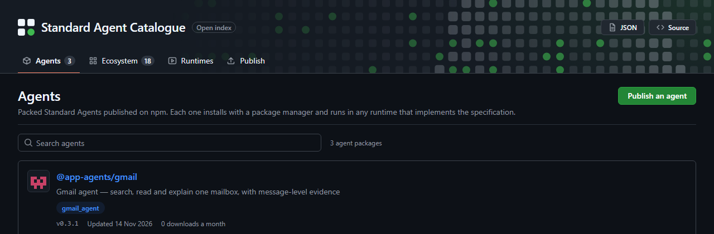
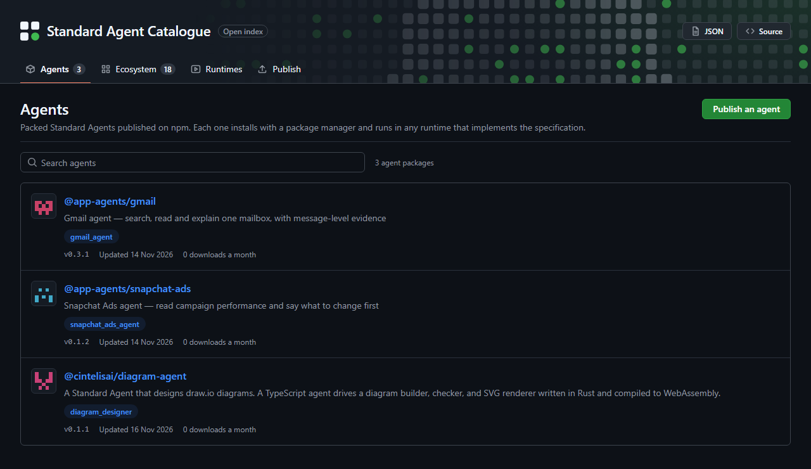
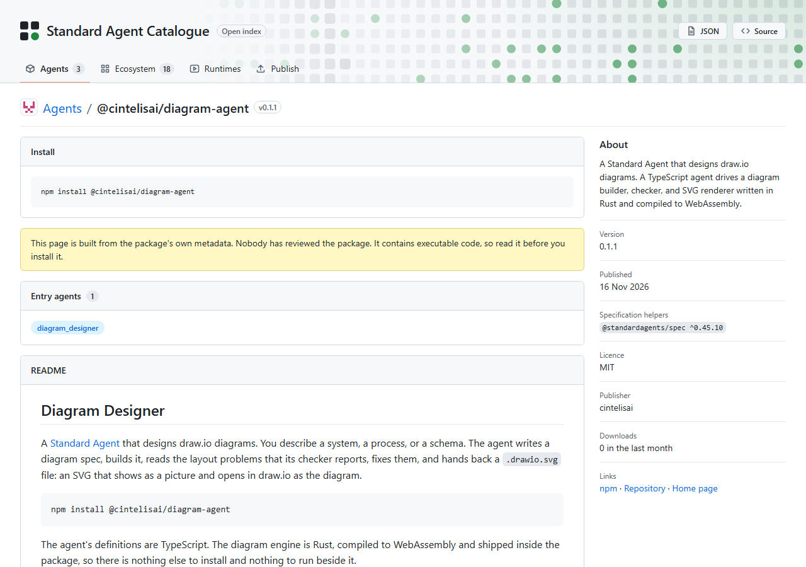
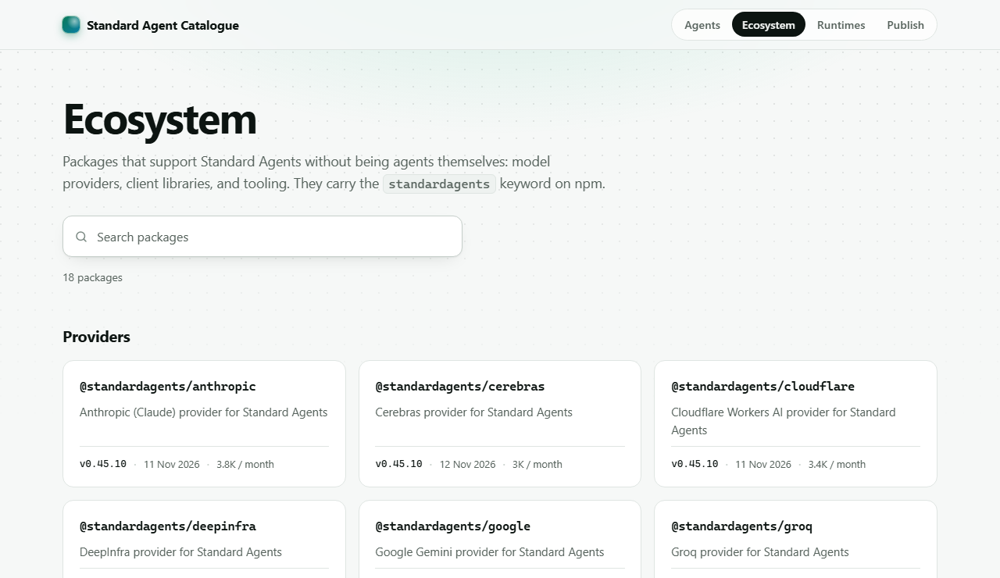
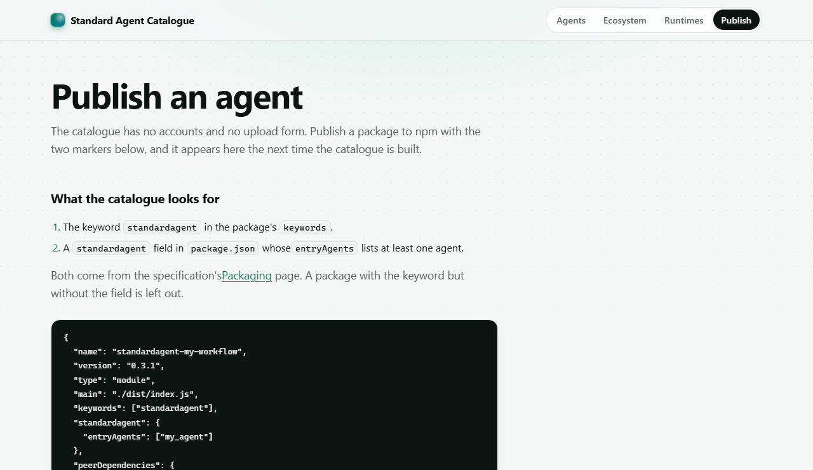
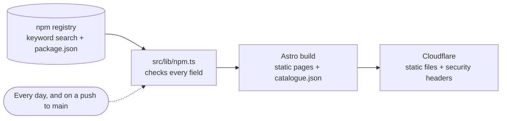
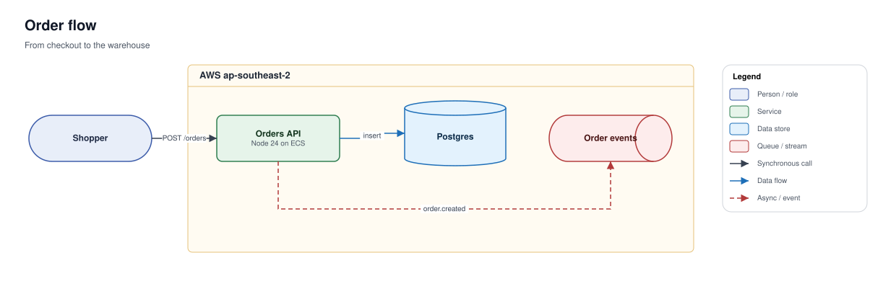

<div align="center">

<a href="https://agents.cintelis.ai"></a>

# Standard Agent Catalogue

**An open index of the Standard Agent packages published on npm.**

It hosts no packages. It reads the public npm registry when it builds,
and it links back to npm.

[](https://agents.cintelis.ai)
[](https://github.com/cintelis/standardagent-catalogue/actions/workflows/ci.yml)
[](https://github.com/cintelis/standardagent-catalogue/actions/workflows/deploy.yml)
[](https://astro.build)
[](package.json)
[](#sample-agents)
[](#keeping-it-current)
[](LICENSE)

[**Open the live site**](https://agents.cintelis.ai) · [What's inside](#whats-inside) · [How it works](#how-it-works) · [Sample agents](#sample-agents) · [**Contribute**](#contributing)

</div>

---

## Why

The [Standard Agent Specification](https://standardagentspec.org) defines a
packed agent as an npm package, so npm is the registry. What npm lacks is a
place to browse only the agents. This site is that index: it finds the packages
that carry the `standardagent` keyword, checks that each one declares its
agents, and gives each a page.

Nobody uploads anything here. To be listed, publish a package to npm with the
keyword and the field, and it appears the next time the site is built. The
site's Publish page shows the exact `package.json`.

## What's inside

<table>
  <tr>
    <td width="50%" valign="top">
      
      <h3>Agents</h3>
      <p>Every npm package with the <code>standardagent</code> keyword and a valid
      <code>standardagent</code> field in <code>package.json</code>, with a search box that
      filters as you type.</p>
      <p><code>/</code> · <code>src/pages/index.astro</code></p>
    </td>
    <td width="50%" valign="top">
      
      <h3>Agent page</h3>
      <p>What one package declares: its entry agents, effects, thread endpoints, and the hooks it
      adds to a parent, then its README, plus its version, licence, and links on npm.</p>
      <p><code>/package/&lt;name&gt;/</code> · <code>src/pages/package/[...name].astro</code></p>
    </td>
  </tr>
  <tr>
    <td width="50%" valign="top">
      
      <h3>Ecosystem</h3>
      <p>Packages that support agents without being one: model providers, client libraries, and
      tooling. They carry the <code>standardagents</code> keyword.</p>
      <p><code>/ecosystem/</code> · <code>src/pages/ecosystem.astro</code></p>
    </td>
    <td width="50%" valign="top">
      
      <h3>Publish</h3>
      <p>The two markers a package needs to be listed, and what its page will show. There are no
      accounts and no upload form.</p>
      <p><code>/publish/</code> · <code>src/pages/publish.astro</code></p>
    </td>
  </tr>
</table>

Two more addresses:

| Address | What it is |
|---|---|
| `/runtimes/` | The runtimes that execute Standard Agents, from `src/data/runtimes.json`, kept by hand |
| `/catalogue.json` | The whole catalogue as JSON, for tools and runtimes that want to read it |

A package with the `standardagent` keyword but no valid field is left out, and
the build prints its name.

## How it works



1. **Read.** The build searches npm for the two keywords and fetches the
   `package.json` of each hit's latest version.
2. **Check.** `src/lib/npm.ts` treats every field as untrusted: it checks the
   type, caps the length, and keeps only plain `http` and `https` links.
3. **Build.** Astro writes one static page for each agent, the lists, and
   `catalogue.json`. No page needs a server.
4. **Publish.** A GitHub Actions workflow builds every day and uploads the
   files to Cloudflare. A failed or empty read publishes nothing.

## Develop locally

For working on a contribution. The site itself is at
[agents.cintelis.ai](https://agents.cintelis.ai).

```bash
pnpm install
pnpm dev      # Start the dev server
pnpm build    # Read npm and build the site into dist/
pnpm preview  # Serve dist/
pnpm test     # Build from tests/fixtures into dist-test/, then check the result
```

`pnpm build` needs network access to `registry.npmjs.org`. A registry failure
fails the build, so a broken read never publishes an empty catalogue.

## Keeping it current

The public site is [agents.cintelis.ai](https://agents.cintelis.ai). Its data
is as fresh as its last build, so it is rebuilt from the npm registry every
day, and again whenever the site's code changes. A package you publish today
appears within a day.

A build that cannot read the registry, or that finds no packages at all,
publishes nothing. The site that is already up stays up.

There is one catalogue, and it gets better when people add to it. To get an
agent listed, publish it to npm. To improve the site or the samples, open a
pull request. [CONTRIBUTING.md](CONTRIBUTING.md) covers both.

## How it treats package data

Every field of a package is written by its publisher, so the catalogue treats
it as untrusted. `src/lib/npm.ts` is the only code that reads the registry:

- It checks each field's type and caps its length.
- It keeps a link only when it is a plain `http` or `https` URL without
  credentials.
- It takes the package's name and keywords from the package's own manifest, not
  from the search index.
- Pages render every value as text.
- A package's page shows its README, but not as the publisher's HTML.
  `src/lib/readme.ts` reads the Markdown and keeps only headings, paragraphs,
  lists, quotes, tables, code, emphasis, and links to plain `http` and `https`
  addresses. It drops raw HTML and pictures. A picture from a publisher's
  server would tell that server who is reading.

`tests/fixtures` includes a hostile package, and `tests/site.test.mjs` checks
that none of its markup or links reach the built pages.

A listing is automatic. It is not a review, an endorsement, or a statement that
a package conforms to the specification.

## Sample agents

Two agent packages to read and change. In each, TypeScript defines the agent and
Rust, compiled to WebAssembly, does the work behind its tools.

| Sample | Does |
|---|---|
| [`examples/text-coach-agent`](examples/text-coach-agent) | Reviews a piece of writing. A small Rust crate counts words and scores readability. Start here |
| [`examples/diagram-agent`](examples/diagram-agent) | Designs draw.io diagrams. A Rust diagram builder, checker, and SVG renderer. Published as `@cintelisai/diagram-agent` |

Each sample is a separate package with its own dependencies and tests, and the
catalogue's build does not include them.

<div align="center">

<br>
<sub>Drawn by the diagram sample from <a href="examples/diagram-agent/test/fixtures/specs/01-order-flow.json">a 20-line spec</a>. The file opens in draw.io for editing.</sub>
</div>

### WebAssembly or a container

The samples show a way to split an agent's work. Put the deterministic,
self-contained work in WebAssembly inside the agent package, and call out to a
sandbox service only for the tasks that need an operating system.

For an agent you want others to install and run, that matters because the
WebAssembly part travels with the package, whereas a container dependency makes
every user provision infrastructure.

| | WebAssembly in the package | Container or sandbox service |
|---|---|---|
| Suits | Work that takes bytes in and gives bytes out: parsing, validating, layout, rendering, text analysis | Running other programs, running code the model wrote, native libraries, direct file or network access |
| Starts in | Milliseconds, inside the agent's own process | Seconds |
| Can reach | Only what the JavaScript hands it | Whatever the sandbox allows |
| Arrives | With `npm install` | As separate infrastructure that each user sets up |

The diagram sample draws this line itself. It ports the diagram builder, the
checker, and the SVG renderer, and it leaves out PNG and PDF export, because
those need a desktop program.

### Compared with LangChain and Copilot Studio

The three answer different questions. A Standard Agent package is something you
hand to other people. LangChain is a library you build your own service with.
Copilot Studio is a hosted builder for agents inside an organisation's
Microsoft 365.

| | Standard Agent package with WebAssembly | LangChain or LangGraph | Microsoft Copilot Studio |
|---|---|---|---|
| What it is | A specification and a package format | A code library for Python and JavaScript | A low-code builder, run by Microsoft as a service |
| What you make | An npm package of definitions: agents, prompts, models, tools | An application whose code drives the agent | An agent set up in a web designer: topics, knowledge, actions |
| Who runs it | Whoever installs it, on a runtime that implements the specification | You, on your own servers, or on LangChain's hosted platform | Microsoft, in the organisation's tenant |
| How others get it | `npm install` | They call your service, or deploy your code themselves | You publish it to Teams, Microsoft 365 Copilot, or a website |
| Where the heavy work runs | In WebAssembly inside the package | In your process, or in containers and sandboxes that you provide | In connectors, Power Automate flows, or services that you host elsewhere |
| What you provision | Nothing beyond the runtime | Compute, a database for state, and often a queue | Licences and an environment, but no servers |
| Control over the agent loop | The runtime owns the loop. You declare the parts | Full. You write the loop | Limited to what the designer offers |
| Reaching business systems | Tools that you write | Many ready-made integrations, and your own code | Ready-made connectors to Microsoft 365 and many other services |
| Who builds it | Developers, in TypeScript and a language that compiles to WebAssembly | Developers, mostly in Python | Makers and analysts, with developers for the custom parts |

**Choose a Standard Agent package** when the agent is a product in itself:
something others install, run on their own runtime, and compose into their own
agents, with its tools travelling inside it.

**Choose LangChain or LangGraph** when you run the service and need to shape the
agent's control flow yourself: custom state, branching, retries, or a Python
stack with libraries that do not compile to WebAssembly.

**Choose Copilot Studio** when the agent is for people inside one organisation,
it works mostly on that organisation's Microsoft 365 data, and it should appear
in Teams or Microsoft 365 Copilot under the organisation's existing sign-in and
data policies.

They also combine. A team can build an agent with LangChain and expose it to
Copilot Studio as an action, and a WebAssembly module of the kind in these
samples runs inside any JavaScript process, whichever framework drives it.

This table describes each product in general terms as of November 2026. All
three change often, and the Standard Agent column describes what this
repository's samples show, not everything the specification allows.

## Continuous integration

`.github/workflows/deploy.yml` rebuilds the site from npm and publishes it
every day, and after each change to the site is merged.

`.github/workflows/ci.yml` runs on every pull request and on pushes to `main`:

- **Catalogue**: builds the site from the fixtures and runs its tests.
- **Each sample**: Rust formatting, lints, and tests, then the TypeScript
  typecheck, then the build and the package tests.

## Contributing

Contributions are welcome, and there are three ways to make one:

- **Publish your own agent.** Put it on npm with the `standardagent` keyword
  and the catalogue lists it within a day. No pull request.
- **Add a sample agent** under `examples/`, for others to read and copy.
- **Improve the site**: the pages, the checks on package data, the look.

[CONTRIBUTING.md](CONTRIBUTING.md) has the steps for each.

## Licence

[MIT](LICENSE). The sample agents are under the same licence, so you can copy
one as the start of your own.

## Structure

```text
src/
├── lib/npm.ts                 # Reads and validates npm data, once per build
├── lib/readme.ts              # Reads a README into a tree that is safe to draw
├── data/runtimes.json         # The runtime list
├── layouts/Base.astro         # Header, navigation, footer
├── components/
│   ├── PackageCard.astro      # One package in a list
│   └── Filter.astro           # Search box that filters the cards on a page
├── pages/
│   ├── index.astro            # Agents
│   ├── ecosystem.astro
│   ├── runtimes.astro
│   ├── publish.astro
│   ├── catalogue.json.ts
│   ├── 404.astro              # Shown for an unknown address
│   └── package/[...name].astro
└── styles/global.css
.github/workflows/
├── ci.yml                     # Tests, on every pull request and push to main
└── deploy.yml                 # Builds from npm and publishes, every day
wrangler.jsonc                 # How Cloudflare serves dist/
docs/screenshots/              # The pictures in this README
tests/
├── fixtures/                  # Saved registry responses for the tests
├── run.mjs                    # Builds from the fixtures, then runs the tests
└── site.test.mjs
```
